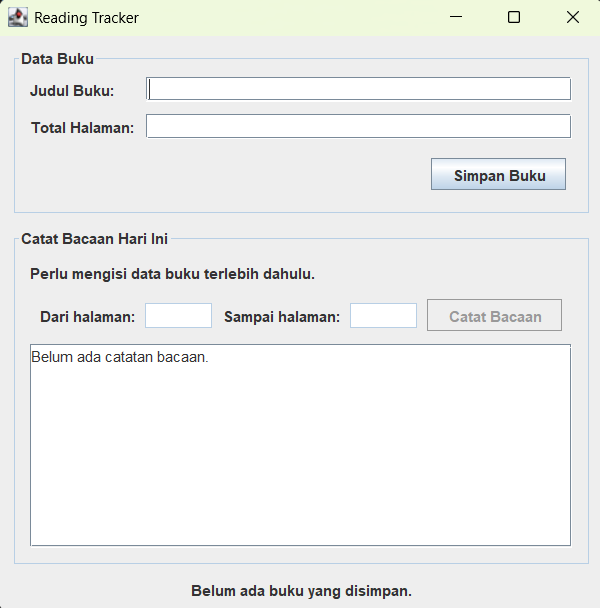
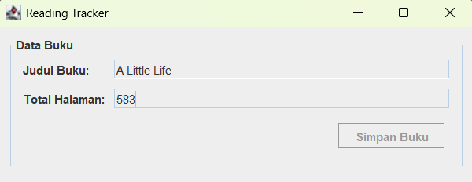
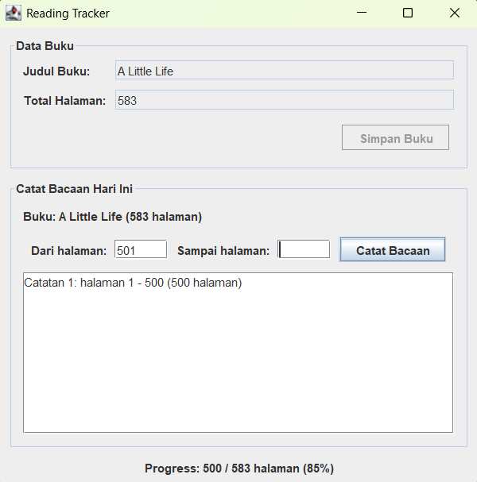
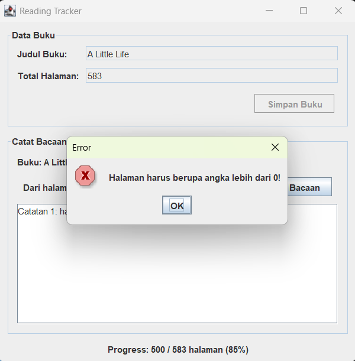
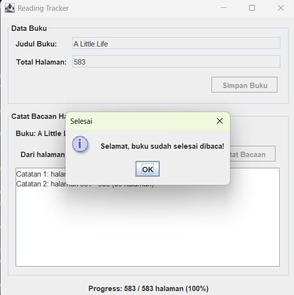

# 📚 Reading Tracker

Aplikasi desktop sederhana berbasis **Java Swing** untuk mencatat progres membaca buku. Kamu tinggal masukkan judul dan total halaman buku, lalu catat halaman yang sudah dibaca setiap harinya. Progresnya (dalam persen) akan dihitung otomatis.

Proyek ini dibuat untuk memenuhi tugas eksplorasi komponen GUI Java Swing.

| | |
|---|---|
| **Nama** | `Fauzan Adhim Mubarak` |
| **NIM** | `F1D02510113` |

---

## ✨ Fitur

- 📖 **Simpan data buku**: isi judul dan total halaman, lalu form otomatis dikunci.
- ✍️ **Catat bacaan harian**: masukkan rentang halaman (dari - sampai).
- 🕘 **Riwayat bacaan**: semua catatan tampil rapi di area riwayat.
- 📊 **Progress otomatis**: menampilkan halaman terakhir yang dibaca dan persentasenya.
- 🛡️ **Validasi input**: ada pesan error kalau input kosong, bukan angka, rentangnya salah, atau melebihi total halaman.
- 🎉 **Notifikasi selesai**: muncul ucapan selamat saat buku sudah habis dibaca.
- ⌨️ **Shortcut Enter**: tekan Enter di kolom *Total Halaman* atau *Sampai Halaman* tanpa perlu klik tombol.

---

## 📸 Screenshot

### 1. Tampilan awal
Saat aplikasi pertama dibuka, bagian catatan masih nonaktif sampai buku disimpan.

]

### 2. Setelah buku disimpan
Form buku terkunci dan bagian catatan bacaan sudah bisa dipakai.

]

### 3. Mencatat bacaan
Riwayat bertambah dan progress ikut diperbarui.

]

### 4. Validasi error
Contoh pesan error ketika input tidak valid.

]
### 5. Buku selesai dibaca
Muncul dialog ucapan selamat saat progress mencapai 100%.

]

---

## 🧩 Komponen GUI yang Digunakan

Berikut pemetaan komponen GUI di kode `ReadingTracker.java` sesuai kriteria tugas.

### 1. Top Level Container

| Class | Fungsi | Lokasi di kode |
|---|---|---|
| `JFrame` | Jendela utama aplikasi, tempat semua komponen diletakkan | variabel `frame`, dibuat di konstruktor dan ditampilkan di `launchFrame()` |

```java
frame = new JFrame("Reading Tracker");
...
frame.setDefaultCloseOperation(JFrame.EXIT_ON_CLOSE);
frame.pack();
frame.setVisible(true);
```

### 2. Intermediate Container

| Class | Fungsi | Contoh variabel |
|---|---|---|
| `JPanel` | Mengelompokkan komponen supaya tata letak lebih teratur | `utama`, `panelBuku`, `panelCatat`, `labelBuku`, `isianBuku`, `barisSimpan`, `barisInput`, `panelAtas` |
| `JScrollPane` | Membungkus `JTextArea` agar riwayat bisa di-scroll | `new JScrollPane(riwayatArea)` |

### 3. Atomic Component

| Class | Fungsi | Contoh variabel |
|---|---|---|
| `JLabel` | Menampilkan teks keterangan dan progress | `infoLabel`, `progressLabel` |
| `JTextField` | Kolom input teks | `judulField`, `totalField`, `dariField`, `sampaiField` |
| `JButton` | Tombol yang bisa diklik | `simpanButton`, `catatButton` |
| `JTextArea` | Area teks untuk riwayat bacaan (hanya baca) | `riwayatArea` |

### 4. Layout Manager (3 jenis, minimal 2)

| Layout | Dipakai untuk |
|---|---|
| `BorderLayout` | Susunan utama jendela (NORTH, CENTER, SOUTH) dan susunan di dalam `panelBuku` serta `panelCatat` |
| `GridLayout` | Menyejajarkan label dan kolom isian pada form data buku (`labelBuku`, `isianBuku`) dan menumpuk `infoLabel` dengan baris input (`panelAtas`) |
| `FlowLayout` | Menata tombol Simpan (rata kanan) dan baris input halaman (rata kiri) |

### 5. Event Listener

Aplikasi memakai interface **`ActionListener`** yang diimplementasikan lewat *inner class*, dengan method `actionPerformed()` yang di-**override**.

```java
private class SimpanHandler implements ActionListener {
    @Override
    public void actionPerformed(ActionEvent e) {
        simpanBuku();
    }
}

private class CatatHandler implements ActionListener {
    @Override
    public void actionPerformed(ActionEvent e) {
        catatBacaan();
    }
}
```

| Handler | Dipasang pada | Aksi |
|---|---|---|
| `SimpanHandler` | `simpanButton` dan `totalField` (Enter) | Menyimpan data buku |
| `CatatHandler` | `catatButton` dan `sampaiField` (Enter) | Mencatat bacaan dan memperbarui progress |

---

## 🚀 Cara Menjalankan

**Yang dibutuhkan:** JDK 8 atau lebih baru (versi yang dipakai: `ISI VERSI JDK KAMU`).

1. Clone repository ini:
   ```bash
   git clone <LINK_REPOSITORY_KAMU>
   cd <NAMA_FOLDER_REPOSITORY>
   ```
2. Compile:
   ```bash
   javac ReadingTracker.java
   ```
3. Jalankan:
   ```bash
   java ReadingTracker
   ```

---

## 🕹️ Cara Pakai

1. Isi **Judul Buku** dan **Total Halaman**, lalu klik **Simpan Buku**.
2. Isi **Dari halaman** dan **Sampai halaman**, lalu klik **Catat Bacaan**.
3. Pantau riwayat dan progress di bagian bawah jendela.
4. Lanjutkan sampai buku selesai. Kolom "Dari halaman" akan terisi otomatis dengan halaman berikutnya.

---

## 📁 Struktur Repository

```
.
├── ReadingTracker.java
├── README.md
└── screenshots/
    ├── awal.png
    ├── simpan.png
    ├── catat.png
    ├── error.png
    └── selesai.png
```

---

